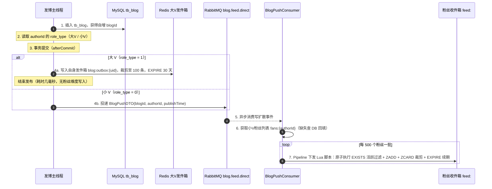
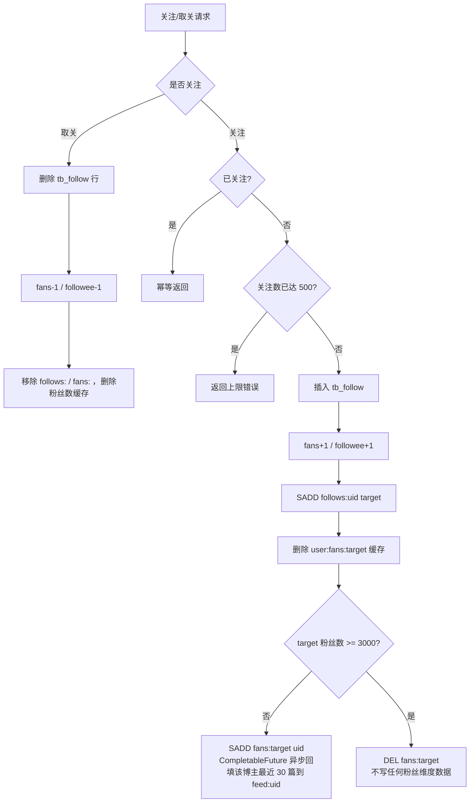

# Feed 关注流（推拉结合架构）设计与实施方案

> 本文档为经过多轮技术推演与架构收敛后的最终设计方案。
> 相关核心文件：[src/main/java/com/hmdp/service/impl/BlogServiceImpl.java](src/main/java/com/hmdp/service/impl/BlogServiceImpl.java)、[src/main/java/com/hmdp/service/impl/BlogPushConsumer.java](src/main/java/com/hmdp/service/impl/BlogPushConsumer.java)、[src/main/java/com/hmdp/service/impl/FeedRebuildConsumer.java](src/main/java/com/hmdp/service/impl/FeedRebuildConsumer.java)、[src/main/java/com/hmdp/service/impl/FollowServiceImpl.java](src/main/java/com/hmdp/service/impl/FollowServiceImpl.java)、[src/main/resources/feed_push.lua](src/main/resources/feed_push.lua)、[src/main/java/com/hmdp/config/RabbitMQConfig.java](src/main/java/com/hmdp/config/RabbitMQConfig.java)、[src/main/java/com/hmdp/utils/RedisConstants.java](src/main/java/com/hmdp/utils/RedisConstants.java)。

---

## 一、架构选型与核心原则

Feed 关注流系统核心解决的是高并发下的**读写极度不对称**（通常读写比在 100:1 以上）。

| 模式 | 实现机制 | 优势 | 缺陷 |
| :--- | :--- | :--- | :--- |
| **纯查库（纯读扩散）** | 刷流时直接查 MySQL 500 个博主并排序 | 写成本低 | 500 个离散 ID 的复杂排序查询瞬间打爆 MySQL，无法抗住读流量 |
| **纯推模式（全写扩散）** | 发博时将动态写入全量粉丝收件箱 | 刷流极快 | 大 V 发博引发严重的写放大、网络堵塞与大量僵尸粉的内存浪费 |
| **推拉结合（本方案）** | **小 V 写扩散（推）+ 大 V 读扩散（拉）** | **兼顾写性能与读吞吐** | 需要处理多源合并、冷启动兜底与状态迁移闭环 |

### 架构核心准则：
1. **轻量索引存储**：Redis 发件箱、收件箱中**仅存储 `blogId` 和时间戳 Score**，绝不存富文本、标题和图片，内存开销控制在 KB 级别。
2. **小 V 彻底剔除发件箱**：全网 99% 的普通博主（小 V）**不维护 Redis 发件箱**，其发文专走写扩散，彻底杜绝小 V 发件箱“纯写不读”的内存浪费。
3. **大 V 专属发件箱**：大 V 坚决不存粉丝集合，专走发件箱读扩散，彻底根治大 V 写风暴与 BigKey。
4. **冷启动首刷无缝（方案 B）**：冷用户（收件箱过期）在打开关注页时，**加分布式互斥锁同步查库双源归并，保障首屏秒出不白屏，同时后台异步原子回填收件箱**。

---

## 二、存储模型设计

### 1. MySQL 结构与必备索引保障

- **`tb_follow`（关注关系表）**：
  - `user_id`（关注者 ID）、`follow_user_id`（被关注者 ID）、`create_time`。
  - **必须索引**：
    - 联合唯一索引：`uk_user_follow(user_id, follow_user_id)`（杜绝并发双击关注导致数据重复与计数虚高）。
    - 辅助索引：`idx_follow_user(follow_user_id)`（用于小 V 粉丝反查与统计）。
- **`tb_user_info`（用户扩展信息表）**：
  - `user_id` 主键、`fans` 粉丝数、`followee` 关注数。
  - **新增角色字段**：`role_type`（TINYINT，0: 普通博主/小 V，1: 大 V），通过持久化状态位消除粉丝数临界抖动。
- **`tb_blog`（博客动态表）**：
  - `id` 主键、`user_id`、`content`、`create_time`。
  - **必须索引**：
    - 联合索引：`idx_user_create(user_id, create_time)`（**方案 B 同步查库与取关清理的核心生命线**，防止千万级数据全表扫描和 filesort）。

### 2. Redis 存储设计（精准边界控制）

| 业务对象 | 数据结构 | Redis Key | Value / Member | Score / 上限 / TTL |
| :--- | :--- | :--- | :--- | :--- |
| **全量关注列表** | Set | `follows:{userId}` | `followUserId` | 单人上限 500 人，无 TTL |
| **大 V 关注列表** | Set | `famousFollows:{userId}` | 大 V 的 `followUserId` | **专属大 V 集合**，关注/取关/升级时维护，**刷流 $O(1)$ 直取** |
| **小 V 粉丝列表** | Set | `fans:{authorId}` | 粉丝 `userId` | **仅小 V 维护**；大 V 坚决不存；无 TTL |
| **个人发件箱** | ZSet | `blog:outbox:{authorId}` | `blogId` | **仅大 V 维护（小 V 不存）**；上限 100 条；TTL 30 天 |
| **个人收件箱** | ZSet | `feed:{userId}` | `blogId` | 小 V 推送与回填；上限 500 条；TTL 7 天（写入滑动续期） |
| **冷启动重建锁** | String | `lock:feed:rebuild:{userId}` | `1` | SETNX 互斥锁，TTL 10 秒，防止冷用户下拉刷新打爆 MySQL |

---

## 三、全生命周期业务链路

### 1. 关注与取关链路（关注分流 + 取关清缓存）

#### (1) 关注流程
1. **DB 落地**：向 `tb_follow` 插入记录（依靠 `uk_user_follow` 联合唯一索引防重）；
2. **计数自增**：`tb_user_info` 更新 `fans + 1` 与 `followee + 1`；
3. **事务提交后（`afterCommit`）操作 Redis**：
   - 将目标博主加入全量关注列表 `follows:{userId}`；
   - **若目标是大 V（`role_type == 1`）**：
     - 加入大 V 关注列表 `famousFollows:{userId}`；
     - 清理可能存在的旧 `fans:{targetId}`；大 V 不向收件箱回填内容（刷流时拉取）。
   - **若目标是小 V（`role_type == 0`）**：
     - 将当前用户加入 `fans:{targetId}`；
     - 从 MySQL `tb_blog` 查出该小 V 最近 30 篇动态（走 `idx_user_create` 索引），批量写入当前用户的收件箱 `feed:{userId}`。

#### (2) 取关流程
1. **DB 物理删除**：删除 `tb_follow` 对应记录，扣减 `fans` 与 `followee` 计数；
2. **查出该博主历史 ID**：从 MySQL 查询该作者最近 500 篇动态的 `id`；
3. **事务提交后（`afterCommit`）彻底清理 Redis**：
   - 从 `follows:{userId}` 移除；
   - 从 `famousFollows:{userId}` 移除（若存在）；
   - 从该作者的 `fans:{targetId}` 移除当前用户；
   - **清理收件箱残留**：从当前用户收件箱执行 `ZREM feed:{userId} id1 id2 ...`，**杜绝取关后仍能刷出旧动态的产品 Bug**。

---

### 2. 发布动态链路（大 V 读扩散 + 小 V 写扩散）



- **小 V 发件箱彻底不写**：直接节约全站绝大多数博主的 ZSet 写入与内存开销。
- **Lua 脚本原子写扩散**：必须在 Lua 内原子执行 `EXISTS`，杜绝 Java Pipeline 内获取到 null 的问题。

---

### 3. 查看关注页链路（方案 B：冷启动首刷无缝体验）

接口入参：`lastId`（上一页最小时间戳，首刷传当前时间戳）、`offset`（偏移量，首刷为 0）。

```mermaid
flowchart TD
    A[用户请求 /blog/of/follow] --> B[读取 famousFollows:uid 获取关注的大V列表 O(1)]
    B --> C{收件箱 feed:uid 存在?}

    %% 分支 1：热用户正常走缓存
    C -- 存在 --> D1[源 1: 从 feed:uid 读取小V动态]

    %% 分支 2：冷用户走方案 B 同步查库 + 异步回填
    C -- 不存在 --> E1[SETNX lock:feed:rebuild:uid 互斥锁]
    E1 --> E2[源 1: 同步查 MySQL 获取关注小V的最新动态]
    E1 --> E3[异步任务: 查小V近7天动态批量回填收件箱]

    %% 汇聚链路
    D1 --> F[源 2: Pipeline 批量拉取各大V发件箱 blog:outbox:vId]
    E2 --> F

    F --> G[PriorityQueue 大顶堆 Top-K 归并排序]
    G --> H[按 blogId 去重 + 统一跳过 offset]
    H --> I[按主键 ID 回查 tb_blog 获取详情]
    I --> J[计算下一页游标 minTime 与 offset 并返回]
```

#### 关键技术点：
1. **$O(1)$ 获取大 V 列表**：直接 `SMEMBERS famousFollows:{userId}` 取出大 V，避免遍历 500 人实时判断粉丝数的性能崩塌。
2. **冷用户首刷不白屏（方案 B）**：
   - 首次打开若收件箱为空，先抢 `SETNX` 互斥锁（10s），防止下拉刷新打爆 DB；
   - 抢到锁的请求同步查 MySQL 小 V 动态，**并拉取大 V 发件箱，内存双源归并，直接返回首屏数据**；
   - 紧接着异步任务从 MySQL 拉取关注小 V 近 7 天动态（上限 100 篇），批量写入激活收件箱。
3. **多源归并 Offset 防放大**：
   - 每路（收件箱/MySQL + 各大 V 发件箱）抓取时，固定抓取 `pageSize + offset` 条；
   - **绝不能将 `offset` 下推到单路**；统一放入大顶堆（Score 降序，同分按 blogId 降序）出堆，去重后在外层统一步进跳过 `offset` 条。
4. **滚动游标累加机制**：
   - `minTime` 取当前页最小时间戳；
   - 若整页数据全部落在边界时间戳 `startTime` 上，`nextOffset = startOffset + 本页条数`；否则取本页内 `score == minTime` 的条数。

---

## 四、博主身份晋升（小 V $\rightarrow$ 大 V）的工程闭环

### 1. 判定机制：双阈值滞回（消除临界抖动）
- **晋升阈值（3500 粉丝）**：粉丝数达到 **3500** 时，才正式触发升级，更新数据库 `role_type = 1`；
- **降级阈值（2500 粉丝）**：粉丝数跌破 **2500** 时，才触发降级，更新数据库 `role_type = 0`；
- **2500 ~ 3500 为稳定缓冲区**，消除边界反复横跳。

### 2. 晋升瞬间异步迁移“三部曲”
当博主粉丝突破 3500 晋升为大 V 时，发送一条 MQ 晋升事件：
1. **预热大 V 发件箱**：从 MySQL `tb_blog` 查询该博主最近 100 篇动态，一次性写入 `blog:outbox:{authorId}`（TTL 30天），彻底解决小 V 晋升大 V 后的“历史内容空窗期”。
2. **销毁小 V 粉丝列表**：直接执行 `DEL fans:{authorId}`，大 V 坚决不留粉丝集合，防止形成 BigKey。
3. **老粉丝大 V 列表补位**：异步分批（每批 500 人）向其老粉丝的 `famousFollows:{fanId}` 中添加该 `authorId`。
4. **老动态天然去重**：老粉丝收件箱里之前残留的该博主旧动态，在刷流多路归并时由 `seen.add(blogId)` 天然过滤，7 天后自然淘汰，零后遗症。

---

## 五、MQ 拓扑规范

| 业务类型 | Exchange | Queue | Routing Key | 机制与死信策略 |
| :--- | :--- | :--- | :--- | :--- |
| **小 V 写扩散** | `blog.feed.direct` (direct) | `blog.feed.push.v2.queue` | `blog.feed.push` | 失败进 TTL 10s 重试队列，超 3 次进死信留档 |
| **收件箱异步回填** | `feed.topic` (topic) | `feed.rebuild.v2.queue` | `feed.rebuild.#` | 失败延迟重试，超 3 次进死信 |
| **大 V 晋升迁移** | `feed.topic` (topic) | `feed.upgrade.queue` | `feed.upgrade` | 负责发件箱预热、DEL 粉丝表、更新老粉丝大V列表 |

重试计数写入消息头 `x-feed-retry-count`，手工 ACK 确认，重投失败保留未确认状态，保障消息零丢失。



- 500 人上限是 `query().eq("user_id", userId).count() >= 500` 的业务校验，不是数据库约束。
- **关注后回填**（`pullBlogFromNewFollow`）：查询该博主最近 30 篇（**不限 7 天**），
  用 `feed_bulk.lua` 一次写入收件箱，裁剪到 500 并续期 7 天。该脚本**不做 EXISTS 判断**，会直接创建收件箱。
- 大 V 关注时执行 `DEL fans:{target}`，防止粉丝集合膨胀成 BigKey。
- **Redis 操作在事务提交后执行**：关注集合、粉丝集合、粉丝数缓存失效、回填任务都通过
  `runAfterCommit` 推迟到 `afterCommit`，事务回滚时不会留下“已关注”的脏状态。
- **取关清理收件箱**：取关时查询该作者最近 `FEED_MAX_LEN`（500）篇的 blogId，
  事务提交后从 `feed:{userId}` 中 `ZREM`。收件箱最多 500 条，因此该作者残留在收件箱里的笔记
  必然落在这 500 篇之内（`FollowServiceImpl.java:160-185`）。

### 4. 刷关注流（`BlogServiceImpl.queryBlogOfFollow`，`BlogServiceImpl.java:337-427`）

接口：`GET /blog/of/follow?lastId={minTime}&offset={offset}`。
注意参数名是 `lastId`，但语义是**上一页的最小时间戳**（`max`），`offset` 是同一时间戳下已返回的条数。

```mermaid
flowchart TD
    A[请求 /blog/of/follow] --> B{feed:uid 存在?}
    B -- 否 --> C[投递 feed.topic 重建消息<br/>本次请求不等待重建]
    B -- 是 --> D[继续]
    C --> D
    D --> E[源 A: ZREVRANGEBYSCORE feed:uid 0..max<br/>取 pageSize+offset 条]
    D --> F[queryFamousFollows 取关注中的大 V]
    F --> G[源 B: Pipeline 批量拉取每个大 V 的<br/>blog:outbox:vId 0..max 取 pageSize+offset 条]
    E --> H[PriorityQueue 归并：score 降序，同分按 blogId 降序]
    G --> H
    H --> I[出堆 + 按 blogId 去重<br/>跳过 score==max 的前 offset 条]
    I --> J{取满 pageSize=3?}
    J --> K[按 id 顺序回查 tb_blog<br/>ORDER BY FIELD 保持堆序]
    K --> L[逐条补作者信息与 isLike]
    L --> M[返回 ScrollResult{list,minTime,offset}]
```

- **offset 不下推**：多源合并时若把 `offset` 传给每个源会被放大 N 倍，因此每源固定多取 `pageSize + offset` 条，
  归并后统一跳过（`BlogServiceImpl.java:353-356`）。
- **归并排序**：Java `PriorityQueue` 是自然序最小堆，这里用反向比较器让堆顶为最大，逻辑上是“大顶堆”。
  同分按 `blogId` 降序，保证多源合并下顺序稳定。
- **去重**：按 `blogId`。正常情况下大 V 内容不进收件箱，不应重复；去重主要兜底“小博主晋升大 V”期间的旧数据。
- **游标**：`minTime = 本页最小 score`。若整页都落在上一页的边界时间戳 `startTime` 上，
  `nextOffset = startOffset + 本页条数`（累计语义）；否则 `nextOffset = 本页中 score == minTime 的条数`。
  空页沿用请求的 `offset`，不会把游标重置为 0 导致客户端重复拉取同一批数据。
- **回填不是批量**：作者信息是 `blogs.forEach(queryBlogUser)` 逐条查 `tb_user`，`isBlogLiked` 逐条查 Redis；
  只有主查询是 `IN` 批量（`BlogServiceImpl.java:414-420`）。
- **冷用户首次刷流可能为空**：重建是异步的，本次请求只返回大 V 发件箱的实时结果；只关注小博主的用户第一页为空。
- **重建触发去重**：收件箱不存在时先 `SETNX feed:rebuild:mark:{uid}`，只有抢到标记的请求才投递 MQ；
  重建完成后（即使没有可重建的数据）把标记续期到 10 分钟。这样「无关注 / 只关注大V / 近期无笔记」的用户
  不会每次刷流都重复投递重建消息（`BlogServiceImpl.triggerRebuild`、`rebuildFeed` 的 finally）。

### 5. 收件箱重建（`FeedRebuildConsumer` + `BlogServiceImpl.rebuildFeed`）

- 触发：刷流时 `hasKey(feed:{uid}) == false`，投递 `feed.topic` / `feed.rebuild` 消息。
- 消费：`rebuildFeed(userId)`（`BlogServiceImpl.java:510-549`）
  1. 查 `tb_follow` 取全部关注；
  2. **逐条**查 `tb_user_info` 过滤出小博主（N+1，最多 500 次）；
  3. 查这些小博主近 7 天的笔记，**全局 `LIMIT 100`**；
  4. `feed_bulk.lua` 批量写入，裁剪 500 条、续期 7 天。
- 重建内容只含小博主；大 V 由刷流实时拉取。重建是幂等的（ZADD 同 member 覆盖）。
- 失败处理：延迟重试队列（TTL 10s）重投，最多 3 次，超限进死信（`FeedRebuildConsumer.java:54-83`）。
- 触发去重：重建完成（包括无数据、甚至异常）后都会在 `finally` 中续期 `feed:rebuild:mark:{userId}`，
  配合刷流侧的 `SETNX`，避免空用户每次刷流都投递重建消息。

---

## 四、MQ 拓扑

| 用途 | Exchange | Queue | 说明 |
| :--- | :--- | :--- | :--- |
| 写扩散 | `blog.feed.direct` | `blog.feed.push.v2.queue` | 消费失败转重试/死信 |
| 写扩散重试 | `blog.feed.retry.direct` | `blog.feed.push.retry.v2.queue` | `x-message-ttl=10s`，过期死信回投业务交换机 |
| 写扩散死信 | `blog.feed.dlx` | `blog.feed.v2.dlq` | 保留待人工补推 |
| 重建 | `feed.topic`（topic） | `feed.rebuild.v2.queue` | 绑定 `feed.rebuild.#` |
| 重建重试 | `feed.rebuild.retry.direct` | `feed.rebuild.retry.v2.queue` | TTL 10s 回投 `feed.topic` |
| 重建死信 | `feed.rebuild.dlx` | `feed.rebuild.v2.dlq` | 同上 |

重试计数放在消息头 `x-feed-retry-count`，最大 3 次（`RabbitMQConfig.java:229-235`）。
重投失败时保留未 ACK 状态（`basicNack(requeue=true)`），不丢消息。

---

## 五、核心问题解答（已按实现校正）

### Q1：大小博主怎么判定？每次都 `COUNT(*)` 吗？

不做 `COUNT(*)`。判定来源是 `tb_user_info.fans`：

- `saveBlog`、`queryFamousFollows`：读 `user:fans:{id}` 缓存（24h），关注/取关时主动失效；
- `BlogPushConsumer`、`rebuildFeed`：直接读 DB。

**注意**：两条链路读的是不同数据源，极端情况下同一博主可能被一处判成大 V、另一处判成小博主，导致重复投递
（刷流有去重兜底）。另外 `fans` 只有在 `tb_user_info` 存在对应行时才会被 `UPDATE` 命中，否则计数永远不增长。

### Q2：关注列表设置 TTL 吗？

不设置。代码里 `follows:{userId}` 只有 `SADD`/`SREM`，没有 `EXPIRE`（`FollowServiceImpl.java:121,159`）。
单人上限 500，数字型成员走 intset 编码，单 Key 约 4KB 量级，不构成 BigKey。

### Q3：2999 个粉丝同时推送的性能？

- MQ 异步解耦，发博主线程只写发件箱 + 发消息；
- 消费者按 500 个收件箱分批，每批一次 Pipeline 往返；
- Lua 中 `EXISTS` 过滤，只为已存在的收件箱写入。

**需要修正的旧说法**：`EXISTS` 过滤的收益取决于收件箱 TTL 的续期方式。TTL 由“被推送”续期，
所以关注了活跃小博主的用户即使长期不登录，收件箱也不会过期，过滤不掉。只有“关注对象都已停更”的用户才会自然过期。
旧文档“通常能过滤 50% 以上僵尸粉”没有数据支撑。

### Q4：粉丝数在 2999/3000 之间抖动怎么办？

代码目前是**单阈值 3000 + 每次实时计算**，没有双阈值、没有 `role_type` 状态位、没有异步迁移。
旧文档中的“双阈值缓冲带 + 状态位固化”是**演进方案，尚未实现**。

现状下跨阈值的实际行为：

- 小博主 → 大 V：后续发博不再写扩散；已在粉丝收件箱中的旧笔记保留到 TTL/裁剪；
  每次有人关注该大 V 都会执行一次 `DEL fans:{id}`；
- 大 V → 小博主：粉丝集合为空，直到下一次发博由 `BlogPushConsumer` 回退 DB 重建集合；
  这期间新粉丝仍会写入 `fans:`，但老粉丝只能在回退时一次性补上。

### Q5：小博主的发件箱有什么用？

`queryBlogOfFollow` 只拉取**大 V** 的发件箱，`rebuildFeed` 与 `pullBlogFromNewFollow` 都读 MySQL。
因此当前实现中小博主的 `blog:outbox:{id}` **没有任何读取方**，属于纯写入。
它唯一的作用是博主晋升大 V 后，粉丝可以立即拉到最近的 100 篇。
旧文档“小博主靠发件箱兜底重建”的说法与实现不符。

---

## 六、已知问题与风险（按优先级）

### P0：功能性缺陷

**P0-1 分页游标可能重复返回 / 回退 —— ✅ 已修复（2026-11-15）**
位置：`BlogServiceImpl.queryBlogOfFollow`、`emptyScrollResult`。

- 原问题：`nextOffset` 取“本页中 score == minTime 的条数”，不是累计值。
  当某一时间戳下的条目跨多页（例如同一 score 有 7 条，pageSize=3）：
  第 2 页返回第 4~6 条并给出 `offset=3`，第 3 页会再次从第 4 条开始，造成重复和翻页死循环。
  整页被 offset 跳空时返回 `offset=0`，游标回退。
- 修复：整页都落在边界时间戳时 `nextOffset = startOffset + 本页条数`；空页沿用请求的 `offset`。
- 未做：`ScrollResult` 仍未提供 `hasMore`，客户端需要以空列表作为终止信号。

**P0-2 取关后收件箱仍保留该博主的笔记 —— ✅ 已修复（2026-11-15）**
位置：`FollowServiceImpl.follow` 取关分支。

- 原问题：取关只删 `tb_follow`、计数、`follows:`、`fans:`，没有从 `feed:{userId}` 移除该小博主的 blogId，
  用户取关后仍会刷到其旧笔记（最长 7 天或直到被 500 条上限挤掉）。大 V 内容实时拉取，不受影响。
- 修复：取关时查询该作者最近 `FEED_MAX_LEN`（500）篇的 blogId，事务提交后 `ZREM feed:{userId}`。
  收件箱最多 500 条，所以该作者残留在收件箱中的笔记必然落在这 500 篇之内。
- 代价：取关时多一次 `tb_blog` 按作者的查询（该表当前缺 `user_id` 索引，见 P0-4 相关的索引建议）。

**P0-3 Redis 写入在 DB 事务内，回滚会留下脏数据 —— ✅ 已修复（2026-11-15）**
位置：`BlogServiceImpl.saveBlog`、`FollowServiceImpl.follow`。

- 原问题：`saveBlog` 的发件箱写入、`follow` 的关注集合/粉丝集合/缓存删除/异步回填都在事务内，
  事务回滚后 Redis 会残留幽灵发件箱条目或“已关注”状态。
- 修复：两处都改为 `TransactionSynchronization#afterCommit` 执行（`runAfterCommit` 辅助方法），
  与 MQ 投递保持同一提交边界。回调异常只记录日志，不影响已提交的业务。

**P0-4 `tb_follow` 缺少唯一索引与查询索引**
位置：`hmdp.sql:72-78`。

- 仓库 Schema 只有主键，**没有**旧文档声称的 `uk_user_follow(user_id, follow_user_id)`。
  并发双击关注时“先查后插”会插入两条，`fans` 被多加。
- `follow_user_id` 无索引：`BlogPushConsumer.listFanIds` 的 DB 回退、`rebuildFeed` 的粉丝统计都是全表扫描。
- 建议：补 `UNIQUE KEY uk_user_follow(user_id, follow_user_id)` 与 `KEY idx_follow_user(follow_user_id)`，
  插入改为捕获重复键。

**P0-5 冷用户重建会被无限触发 —— ✅ 已修复（2026-11-15）**
位置：`BlogServiceImpl.queryBlogOfFollow`、`triggerRebuild`、`rebuildFeed`。

- 原问题：只要 `feed:{userId}` 不存在就投一条重建消息，没有防抖；`rebuildFeed` 在
  “没有关注 / 只关注大 V / 近 7 天无笔记”时直接 return 且不创建 key，导致这类用户每次刷流都投一条 MQ。
- 修复：`triggerRebuild` 用 `SETNX feed:rebuild:mark:{uid}`（TTL 1 分钟）去重；
  `rebuildFeed` 在 `finally` 中把标记续期到 10 分钟，即使没有可重建的数据也不会被反复触发。
- 遗留：收件箱仍然只在有数据时创建；空用户的内容恢复依赖下一次重建或关注后回填（P0-6）。

**P0-6 关注后回填会“锁死”不完整的收件箱**
位置：`FollowServiceImpl.java:131-138`、`FollowServiceImpl.java:169-193`。

- `feed_bulk.lua` 不检查 Key 是否存在，关注时会把收件箱直接建出来，内容只有新关注博主的最近 30 篇。
- 如果用户此前 7 天未活跃、收件箱已过期、其他小博主的内容尚未重建，此时关注一个人会“抢先”建出一个残缺收件箱；
  后续刷流看到 Key 存在，不会再触发重建，其他博主的内容要等他们再次发博才会出现。
- 建议：回填前判断 Key 是否存在，不存在时先触发完整重建；或回填时把 Key 视为“临时/不完整”并打标记。

### P1：性能问题

**P1-1 `queryFamousFollows` 每次刷流最多 500 次 Redis GET**
位置：`FollowServiceImpl.java:235-244`。循环里逐个 `get(user:fans:{id})`，应改为 `multiGet`。
这是刷流主链路，与“极速响应”的目标相矛盾。

**P1-2 `rebuildFeed` 逐条查 `tb_user_info`**
位置：`BlogServiceImpl.java:516-523`。最多 500 次 SQL，应改为 `IN` 批量查。

**P1-3 刷流回填逐条查作者 / 点赞**
位置：`BlogServiceImpl.java:414-420`。`queryBlogUser` 逐条 `getById`，`isBlogLiked` 逐条 Redis；
PageSize=3 时影响有限，但旧文档“批量补充作者与点赞信息”的描述不准确。

**P1-4 `CompletableFuture.runAsync` 使用公共 ForkJoinPool**
位置：`FollowServiceImpl.java:136-138`。内部是阻塞的 DB + Redis 调用，会占用 commonPool；异常也被吞掉。
建议使用独立线程池，或干脆走 MQ。

**P1-5 消费端粉丝集合回填无上限/无 TTL**
位置：`BlogPushConsumer.java:285-287`。小博主受 3000 阈值保护，但集合只在“缺失”时重建，
成员一旦脏了（例如取关链路漏删）不会自愈，也没有过期时间。

### P2：文档/实现口径问题（已在本文修正）

1. 收件箱 TTL 是“最后一次写入后 7 天”，不是“最后一次登录后 7 天”。
2. 源 A 分页参数是 `pageSize + offset`（`pageSize=3`），旧文档写的 `LIMIT offset 5` 不成立。
3. 旧文档提到“凌晨后台对账任务校正 fans”，代码中只有秒杀的库存对账，**没有** fans 对账任务。
4. 旧文档称 `tb_follow` 有唯一索引，仓库 Schema 中没有。
5. 旧文档称“小博主靠发件箱兜底重建”，实际重建读 MySQL，小博主发件箱没有读取方。
6. 旧文档称 Pipeline 把 2999 次 RTT 降为 6 次——实际是 6 次 Pipeline 往返、约 3000 条 EVAL 命令。
7. 旧文档 Q4 的双阈值方案未实现，应标注为演进方向。
8. 旧文档“EXISTS 能过滤 50% 以上僵尸粉”无依据，TTL 续期机制决定该收益有限。
9. 关注后回填的 30 篇不受 7 天时间窗限制。
10. 重建的 `LIMIT 100` 是跨全部小博主的全局限制，高产博主可能挤掉其他博主的内容。

---

## 七、演进方向

### 已落地（2026-11-15）

- 重建触发去重：`SETNX` 标记 + 重建完成后续期（P0-5）。
- 取关清理收件箱：按作者最近 500 篇 blogId `ZREM`（P0-2）。
- 滚动游标累计语义 + 空页保留 offset（P0-1，`hasMore` 仍未提供）。
- Redis 写入统一移到事务提交后（P0-3）。

### 待办

1. **状态位固化**：`tb_user_info` 增加 `blogger_role`，双阈值（如 3500 晋升 / 2500 降级）+ 异步迁移，
   消除单阈值抖动和跨链路判定不一致。
2. **判定口径统一**：抽一个 `isFamous(authorId)` 服务方法，所有链路（发博、推送、重建、刷流）共用，缓存与 DB 只保留一处真源。
3. **`ScrollResult` 增加 `hasMore`**：让客户端不必依赖“空列表”判断结束，并彻底消除同分跨页的边界歧义。
4. **索引与唯一约束**：`tb_follow` 补 `(user_id, follow_user_id)` 唯一索引与 `follow_user_id` 普通索引；
   `tb_blog` 补 `user_id` 索引（当前取关清理、按作者查询与重建都是全表扫描）。
5. **`fans` 定时对账**：校正 `tb_follow` 实际条数与 `tb_user_info.fans`，修复缺失行导致的计数不增长。
6. **收件箱初始化标记**：解决 P0-6（关注回填抢先建出残缺收件箱）。
7. **小博主发件箱**：要么去掉写入节省内存，要么让重建优先读发件箱，明确其数据职责。