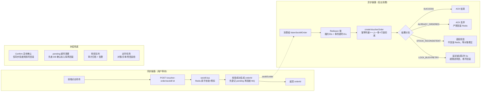
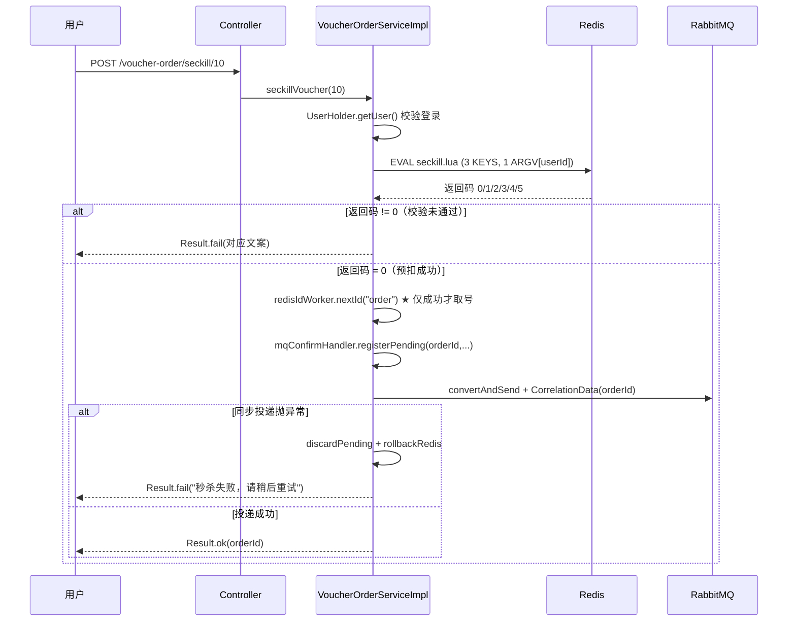

# 优惠券秒杀链路梳理

> 对应代码版本：Spring Boot 3.5.1 / JDK 21 / MyBatis-Plus 3.5.7 / Redisson 3.25.0
> 最后更新：2026-11-08

---

## 一、总体架构

秒杀的核心约束是**高并发下不超卖、一人一单、异步削峰、消息不丢、杜绝幽灵复活**。项目采用「**Redis 原子预扣 + MQ 异步落库 + 精细化消费决策 + 定时补偿**」架构。



**设计要点**

| 关注点 | 手段 |
|---|---|
| 不超卖 | Lua 原子扣减（第一道）+ DB `WHERE stock > 0`（第二道）+ 定时对账覆盖 |
| 一人一单 | Lua 内 `SISMEMBER`（第一道）+ DB `uk_user_voucher` 唯一索引 + 判重（第二道） |
| 杜绝幽灵复活 | 用户已有其他订单时（`ALREADY_ORDERED`）**绝对不回滚 Redis**，严防误删成功订单的 `sadd` 标记 |
| 削峰与防浪费 | 同步链路只做 Redis 操作；**仅在 Lua 校验通过后才生成全局订单号**，被拒请求不耗号 |
| 锁安全不变式 | Redisson 显式租约 30s + Spring `@Transactional(timeout = 15)`，保证事务在锁释放前结束 |
| 消息不丢 | 手动 ACK + publisher-confirm/return + 延迟重试队列 + 死信队列 |
| 数据最终一致 | 幂等回滚脚本（只由同步投递失败调用）+ 定时库存对账 + 超时关单 |

---

## 二、数据结构

### 2.1 MySQL 表

**`tb_voucher`**：优惠券主表，`type = 1` 表示秒杀券。

**`tb_seckill_voucher`**：秒杀券扩展表，主键即 `voucher_id`。

| 字段 | 说明 |
|---|---|
| `voucher_id` | 主键，关联 `tb_voucher.id` |
| `stock` | 剩余库存（DB 侧真实值） |
| `begin_time` / `end_time` | 活动起止时间 |

**`tb_voucher_order`**：订单表。

| 字段 | 说明 |
|---|---|
| `id` | 主键，**非自增**，由 `RedisIdWorker` 生成 |
| `user_id` / `voucher_id` | 下单用户与券 |
| `status` | 1 未支付 / 2 已支付 / 3 已核销 / 4 已取消 / 5 退款中 / 6 已退款 |
| `pay_type` | NOT NULL 默认 1 |
| `create_time` | 下单时间，超时关单依据 |
| **`uk_user_voucher`** | **唯一联合索引 (`user_id`, `voucher_id`)**，并发穿透时由 DB 强约束杜绝重复单 |

### 2.2 Redis 键

| Key | 类型 | 值 / 用途 | TTL |
|---|---|---|---|
| `seckill:stock:{voucherId}` | String | 剩余库存（抢单第一依据） | `end_time + 24h` |
| `seckill:order:{voucherId}` | Set | 已下单的 userId 集合（一人一单第一防线） | `end_time + 24h` |
| `seckill:time:{voucherId}` | String | `"{beginMillis}:{endMillis}"` 时间窗口 | `end_time + 24h` |
| `icr:order:{yyyy:MM:dd}` | String | 订单号自增序列号，首次自增设 2 天过期 | 2 天 |
| `lock:order:{userId}:{voucherId}` | RLock | Redisson 分布式锁，锁粒度为「用户+券」，租约 30s | 30 秒 |
| `seckill:dlq:record` | List | 死信审计记录（JSON），保留最近 1000 条 | 无 |

### 2.3 MQ 拓扑

| 组件 | 名称 | 说明 |
|---|---|---|
| 业务交换机 | `seckill.direct`（direct） | 路由键 `seckill.order` |
| 业务队列 | `seckill.order.queue` | durable，**挂载 DLX** |
| 重试交换机 | `seckill.retry.direct` | 路由键 `seckill.order.retry` |
| 重试队列 | `seckill.order.retry.queue` | `x-message-ttl=5000`，死信回业务交换机 |
| 死信交换机 | `seckill.dlx` | 路由键 `seckill.order.dlq` |
| 死信队列 | `seckill.order.dlq` | durable，最终失败消息，人工核对凭证 |

---

## 三、阶段一：活动创建与预热

**入口**：`VoucherController.addSeckillVoucher` → `POST /voucher/seckill`

`VoucherServiceImpl.addSeckillVoucher()`（`@Transactional`）：

1. **参数校验**：库存非空且 `>= 0`，开始与结束时间非空且 `endTime > beginTime`
2. 强制设 `type = 1`，分别写入 `tb_voucher` 与 `tb_seckill_voucher`
3. **`cacheSeckillVoucher()` 预热 Redis**：
   - 写入 `seckill:stock:{id}` 与 `seckill:time:{id}`
   - 续期 `seckill:order:{id}`，TTL 设为 `end_time + 24h - now`（兜底 1 分钟）
   - **时区固定**：强制采用 `SystemConstants.BIZ_ZONE_ID`（`Asia/Shanghai`）解释无时区字面量，不依赖 JVM 默认时区

---

## 四、阶段二：抢单（同步链路）

**入口**：`VoucherOrderController.seckillVoucher` → `POST /voucher-order/seckill/{id}`



### 4.1 Lua 脚本原子校验（`seckill.lua`）

- **KEYS**: `[1] stockKey`, `[2] orderKey`, `[3] timeKey`
- **ARGV**: `[1] userId`（`voucherId` 已在 Key 中，`orderId` 由应用侧生成，无需传参）
- **核心逻辑**：
  1. 使用 Redis 服务端 `TIME` 取统一时间戳，避免节点 NTP 漂移
  2. 校验时间窗口（未开始返回 3，已结束返回 4）
  3. 校验库存（不存在返回 5，库存不足返回 1）
  4. 校验一人一单（已存在返回 2）
  5. 扣减库存 `INCRBY -1` 并登记用户 `SADD`，返回 0

### 4.2 订单号生成与投递原则

1. **先判断再取号**：`r != 0` 时直接短路返回，被拒绝的高频点击不会白耗 Redis 序列号
2. **先登记再投递**：先 `registerPending` 登记到本地缓存，再执行 `convertAndSend`，避免异步确认早于登记到达
3. **同步投递异常处理**：若 `convertAndSend` 同步抛出异常，立即 `discardPending` 并调用 `rollbackRedis(voucherId, userId)`，同步返回失败

---

## 五、阶段三：异步落库（消费链路）

`VoucherOrderServiceImpl.listenSeckillOrder()`，手动 ACK 模式。

### 5.1 分布式锁与事务强约束

消费端加锁采用 Redisson：
```java
isLock = redisLock.tryLock(LOCK_WAIT_SECONDS, LOCK_LEASE_SECONDS, TimeUnit.SECONDS);
```
- `LOCK_WAIT_SECONDS = 3L`
- `LOCK_LEASE_SECONDS = 30L`
- **事务超时约束**：`createVoucherOrder` 显式标注 `@Transactional(rollbackFor = Exception.class, timeout = 15)`
- **不变式保证**：事务在第 15 秒强制超时回滚，必定早于 30 秒租约结束，杜绝锁静默失效带来的并发穿透。

### 5.2 消费落库结果分流（`OrderCommitOutcome`）

落库方法严格划分为三态，**废弃原本单一的 boolean 与盲目回滚逻辑**：

| 业务执行结果 | 场景判断 | 处理策略 | Redis 动作 | MQ 动作 |
|---|---|---|---|---|
| **`SUCCESS`** | `getById(orderId) != null` 或本次 `save()` 成功 | 订单落库成功或幂等命中 | 不动 | `channel.basicAck` |
| **`ALREADY_ORDERED`** | `count(userId, voucherId) > 0` | 排除本订单后，发现该用户已有**另一笔已落库订单** | **严禁回滚！**（否则抹除成功订单标记导致幽灵复活） | 打警告日志，`channel.basicAck` 丢弃消息 |
| **`STOCK_INCONSISTENT`** | `WHERE stock > 0` 扣减返回 0 | DB 库存实际已空，但 Redis 曾预扣成功 | **严禁回滚！**（回滚会导致 Redis 偏离持续扩大，后续请求继续空转） | `publishToDlq` 进死信队列待人工与对账处理，`channel.basicAck` |
| **`LOCK_BUSY / RETRY`** | 获取锁超时，或消费过程抛未知异常 | 锁竞争或临时网络/DB 抖动 | **严禁回滚！**（预扣依然有效） | 重试 `< 3` 次进延迟队列，超限进死信队列 |

---

## 六、阶段四：失败补偿体系

### 6.1 投递确认处理（`SeckillMqConfirmHandler`）

- 实现 `RabbitTemplate.ConfirmCallback`
- `confirm(correlationData, ack, cause)`：
  - `!ack` 或 `correlationData.getReturned() != null` 时触发回滚
- **`cleanStalePending()` 超时清扫机制**：
  - 每 60 秒巡检超期未确认的消息
  - **关键防御**：**先调用 `voucherOrderMapper.selectById(orderId)` 确认订单未落库，才允许执行 `rollback`**。防止因 broker 回执延迟导致误删已落库订单的用户标记。
  - 容量警戒：未确认条数超 5000 时输出 ERROR 告警。

### 6.2 延迟重试与死信机制

1. **延迟重试队列**：
   - 消息推入 `seckill.order.retry.queue`，TTL 为 5000ms
   - TTL 到期后由 RabbitMQ 死信路由重新投递到主业务队列，实现平滑退避，避免 `requeue=true` 导致 CPU 跑满
2. **死信队列（`SeckillDlqConsumer`）**：
   - 记录订单 ID、用户 ID、券 ID、失败原因及时间戳
   - 写入 Redis `seckill:dlq:record` List（保留最近 1000 条），记录成功后 ACK
   - **只做审计与告警，不自动重放**

### 6.3 定时巡检维护（`SeckillMaintenanceTask`）

在 `application.yml` 中配置独立任务调度线程池（`size = 4`），消除多任务间的串行等待阻塞：

| 任务 | 周期 | 核心处理 |
|---|---|---|
| `reconcileStock` | 每 10 分钟 | 扫描进行中活动，Redis 键缺失按 DB 重建；不一致时以 DB 为准强制覆盖 Redis |
| `closeTimeoutOrders` | 每分钟 | 查出超时 15 分钟未支付订单，条件更新状态 1→4，DB 库存 +1，Redis 库存 +1，`SREM` 释放一人一单标记 |
| `checkDlqBacklog` | 每 5 分钟 | 检查死信队列积压深度与审计日志条数，非零立即输出告警 |

---

## 七、异常场景全景对照表

| # | 场景 | 预扣状态 | 应对动作 | 最终影响 |
|---|---|---|---|---|
| 1 | Lua 校验未通过 | 未预扣 | 立即返回失败提示 | 不占号、不扣减 |
| 2 | MQ 同步投递抛异常 | 已预扣 | `discardPending` + `rollbackRedis` | 同步报错，库存与用户标记归还 |
| 3 | broker 未接收 / 路由失败退回 | 已预扣 | Confirm 回调触发回滚 | 最终释放库存与用户标记 |
| 4 | Confirm 回执严重超时（>60s） | 已预扣 | 清理任务**先查库确认**，未入库才回滚 | 杜绝成功订单标记被误删 |
| 5 | 消费端获取分布式锁超时 | 已预扣 | 投递延迟队列（5s 后重试），**不回滚** | 平滑重试，不产生抖动 |
| 6 | 消费时发现已有其他订单 | 已预扣 | **不回滚 Redis**，直接 ACK 丢弃重复单 | 成功订单标记不受损，杜绝幽灵复活 |
| 7 | DB 库存不足（两端数据不一致） | 已预扣 | **不回滚 Redis**，直接转死信 | 阻断持续空转，等定时对账覆盖修复 |
| 8 | 消费端抛出未知运行时异常 | 已预扣 | 捕获为 `RETRY`，延迟重试，**不回滚** | 给数据库抖动留出恢复时间 |
| 9 | 重试超过 3 次 | 已预扣 | 投递死信队列，**不回滚** | 保留现场，人工介入核对 |
| 10 | 订单 15 分钟未支付 | 已落库 | 事务化超时取消：状态置 4、双端库存归还、`SREM` 释放标记 | 释放购买资格与库存 |
| 11 | Redis 宕机重启丢失数据 | 状态缺失 | 定时对账任务按 DB 完整重建 | 自动恢复 |
| 12 | Redis 与 DB 出现数量偏差 | 数据偏离 | 定时对账任务以 DB 为基准覆盖 Redis | 自动修正 |

---

## 八、关键设计约束与运维注意

1. **RabbitMQ 队列参数变更限制**：
   - 为现有队列配置 `x-dead-letter-*` 或 `x-message-ttl` 会触发 `PRECONDITION_FAILED`。环境升级必须在控制台删除旧队列后由程序自动创建。
2. **时区强一致性**：
   - 数据库连接字面量解析与 Java 端时间计算已统一绑定 `Asia/Shanghai`，容器部署必须保证数据库时区配置统一。
3. **分布式锁粒度与降级**：
   - `lock:order:{userId}:{voucherId}` 锁粒度仅约束同用户同券的并发写入。并发重复消息最终依赖 `uk_user_voucher` 唯一索引兜底。
4. **人工介入工作流**：
   - 进入死信队列的消息代表异常状态，运维/客服可直接读取 `seckill:dlq:record`，根据关联的 `orderId` 判断是补单还是退款。
| 低 | 秒杀结果轮询接口 | 目前前端拿到 orderId 后无查询入口，可加 `GET /voucher-order/{id}` |
| 低 | 压测与阈值调优 | `prefetch`、连接池、Redisson 锁等待时间需按实际 QPS 调整 |